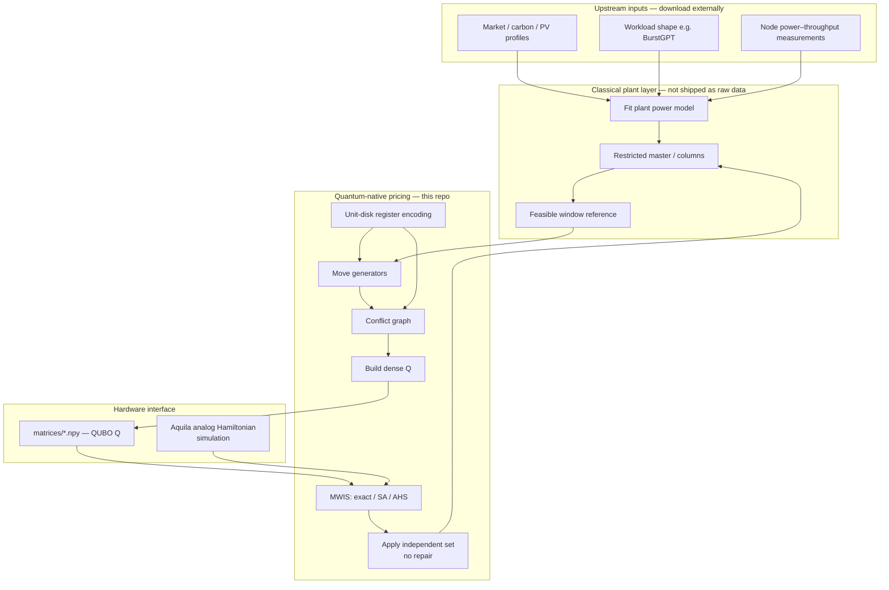
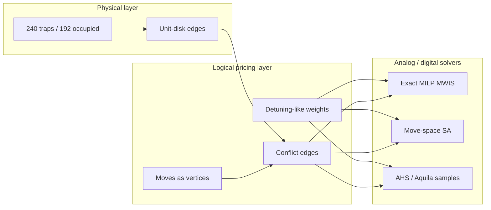

# Hybrid quantum–classical MWIS pricing for AI token factories

Public research code for **move-space maximum-weight independent set (MWIS)
pricing** on a neutral-atom (Rydberg) unit-disk register, embedded in an
energy- and carbon-aware AI token-factory scheduler.

This repository distributes **algorithms** and **derived quantum-ready matrices**
only. Raw market time series, workload traces, and full campaign logs are
**not** redistributed; public sources are linked below for independent download.

---

## 1. What this package is (and is not)

| Distributed here | Not distributed |
|------------------|-----------------|
| 240-site triangular unit-disk encoding (192 occupied sites) | Raw CAISO / PJM / ERCOT price–carbon CSVs |
| Move-space MWIS pipeline (exact MILP, classical heuristics, AHS surrogate) | BurstGPT / NLR measurement dumps |
| Hash-locked dense QUBO matrices \(Q\) for hardware / classical loaders | Monthly campaign JSONL, Aquila shot logs |
| Rebuild scripts that regenerate \(Q\) from locked recipes | Proprietary operator traces |

**Data boundary.** Downstream of classical pricing, the object handed to a
quantum (or quantum-inspired) solver is a **dense QUBO matrix** \(Q\) with
energy \(E(\mathbf{x})=\mathbf{x}^{\top}Q\mathbf{x}\). That is the last data
product in this repository. Everything upstream of \(Q\) must be obtained from
the linked public sources or regenerated by the user.

---

## 2. Problem setting

A token-serving plant is scheduled over a month by a **restricted master
problem** (RMP): each four-hour window selects one immutable micro-schedule
column. Columns are proposed by pricing subproblems. The quantum-native pricing
view is:

1. Start from a feasible window reference bitstring on the physical register.
2. Generate a catalogue of **local moves** (island compute level, battery
   action, batch flag, block swaps).
3. Treat mutually incompatible moves as a **conflict graph**.
4. Solve a **maximum-weight independent set** on that graph.
5. Apply the selected moves **without bit repair**; admit the column only if
   the forward model and exact reduced-cost tests pass.

The same MWIS is the ground-state problem of a blockaded Rydberg array when
vertices are atoms (or effective move qubits) and edges are blockade /
logical exclusions.



---

## 3. Quantum mechanism

### 3.1 Rydberg blockade and unit-disk MWIS

Neutral-atom processors (e.g. QuEra **Aquila** on Amazon Braket) trap atoms in
programmable traps and drive a ground \(\leftrightarrow\) Rydberg transition.
Within a blockade radius \(R_b\), at most one atom may occupy the Rydberg
state: the interaction is a soft hard-core constraint on the unit-disk graph
induced by trap coordinates.

For binary variables \(x_i\in\{0,1\}\) (Rydberg occupation) with weights
\(w_i\) and edges \(E\),

\[
\max_{\mathbf{x}} \sum_i w_i x_i
\quad\text{s.t.}\quad
x_i x_j = 0 \ \forall (i,j)\in E
\]

is MWIS. Aquila realises the same structure in analog form: local detuning
programmes \(\{w_i\}\), and the van der Waals interaction enforces
near-blockade on geometrically close pairs
([Pichler et al., arXiv:1808.10816](https://arxiv.org/abs/1808.10816);
[QuEra / Braket Aquila](https://docs.aws.amazon.com/braket/latest/developerguide/braket-devices.html)).

### 3.2 Physical register in this work

`algorithms/encoding.py` fixes a **15×16** staggered triangular layout
(semantic row × slot):

| Quantity | Value |
|----------|------:|
| Register sites | 240 |
| Occupied / weighted sites | 192 |
| Vacant guard sites | 48 |
| Blockade radius \(R_b\) | 8.9 µm |
| Minimum spacing | 5.0 µm |

Occupied sites carry compute, battery, and batch propositions. Guard sites are
present in the template but carry zero local weight. Geometric edges beyond the
six intended same-slot logical exclusions are disclosed as conservative
codebook restrictions: they shrink the representable schedule set relative to a
pure logical model.

### 3.3 Move-space MWIS (logical quantum problem)

Hardware need not enumerate all \(2^{240}\) register states. Pricing builds a
much smaller **move graph**:

- Vertices = candidate local edits about a feasible reference.
- Edges = simultaneous incompatibility (same asset, conflicting battery
  actions, geometric collisions after apply, …).
- Weights = reduced-cost / score estimates for each move.

The confirmatory artefact shipped here uses \(K=64\) vertices (seed 104).
Exact MWIS, simulated annealing on the move graph, and an AHS-style surrogate
sampler all target the same independent-set objective. Returned bitstrings are
decoded to register updates **without repair**; invalid or non-improving
columns are rejected by classical gates.



### 3.4 QUBO form handed to solvers

Independent-set MWIS with penalty \(P > 2\max_i|w_i|\) maps to an unconstrained
QUBO (standard construction):

\[
Q_{ii} = -w_i,\qquad
Q_{ij}=Q_{ji}=\frac{P}{2}\ \text{for each conflict edge }(i,j),\qquad
P = 1 + 2\max_i|w_i|.
\]

Minimise \(E(\mathbf{x})=\mathbf{x}^{\top}Q\mathbf{x}\). Implementation:
`algorithms/qubo.py::build_qubo_matrix`.

For devices that expect Ising \((J,h)\) rather than QUBO \(Q\), apply the affine
map \(s_i=1-2x_i\). The **object of record in this repository remains \(Q\)**
(`.npy`), i.e. the matrix a quantum or quantum-inspired backend should load.

### 3.5 Analog Hamiltonian picture (Aquila)

In the Rydberg AHS language (schematic):

\[
H(t)=\sum_i \frac{\Omega(t)}{2}\sigma_i^x
-\sum_i \Delta_i(t)\,n_i
+\sum_{i<j}V_{ij}n_i n_j,
\quad n_i=\lvert r\rangle\langle r\rvert_i,
\]

with \(V_{ij}\propto (R_b/r_{ij})^{6}\). Global pulse \(\Omega(t)\) and
time-dependent detunings \(\Delta_i(t)\) steer the register toward low-energy
independent sets; blockade supplies the quadratic penalties. This package does
not ship pulse waveforms or shot records—only the **logical \(Q\)** (and the
encoding needed to rebuild physical kernels).

---

## 4. Matrices (quantum / classical solver inputs)

All numerical datasets **in-repo** live under `matrices/` and are **derived**.

| File | \(n\) | Role |
|------|------:|------|
| `register_unit_weight_Q.npy` | 240 | Canonical unit-weight MWIS on the physical UDG |
| `move_mwis_k64_seed104_Q.npy` | 64 | Confirmatory move-space MWIS (seed 104) |
| `move_mwis_k64_seed104_instance.json` | — | Locked weights/edges recipe to rebuild the move \(Q\) |
| `*_meta.json`, `MANIFEST.json` | — | Shapes, penalties, SHA-256 locks |

```bash
python scripts/export_matrices.py
```

| Matrix | SHA-256 (prefix) |
|--------|------------------|
| `register_unit_weight_Q.npy` | `d27660d1…` |
| `move_mwis_k64_seed104_Q.npy` | `07b6d5c4…` |

```python
import numpy as np
Q = np.load("matrices/move_mwis_k64_seed104_Q.npy")
# Load into a QUBO / Ising backend; E = x @ Q @ x
```

See [`matrices/README.md`](matrices/README.md).

---

## 5. External data (download; do not commit here)

Obtain upstream inputs from the publishers. Do **not** add raw CSVs or
measurement dumps to this repository.

| Need | Source | Link |
|------|--------|------|
| GPU node power & serving (NLR Kestrel Llama-3-70B) | OpenEI submission 6666 | [data.openei.org/submissions/6666](https://data.openei.org/submissions/6666) |
| Interactive / batch traffic shape | BurstGPT | [github.com/HPMLL/BurstGPT](https://github.com/HPMLL/BurstGPT) |
| BurstGPT trace file (pinned commit) | Raw CSV | [BurstGPT_1.csv](https://raw.githubusercontent.com/HPMLL/BurstGPT/8345c824bf744e21692186af2835521ba75e5f6d/data/BurstGPT_1.csv) |
| CAISO prices & related ISO data | CAISO OASIS | [oasis.caiso.com](https://oasis.caiso.com/mrioasis/logon.do) |
| Grid carbon factors (US) | EPA eGRID | [epa.gov/egrid](https://www.epa.gov/egrid) |
| PV / irradiance (if regenerating PV) | NREL NSRDB | [nsrdb.nrel.gov](https://nsrdb.nrel.gov/) |
| H100 / DGX datasheet references | NVIDIA | [DGX H100 datasheet](https://www.nvidia.com/content/dam/en-zz/Solutions/Data-Center/nvidia-dgx-h100-datasheet.pdf) |
| Neutral-atom device access | Amazon Braket – Aquila | [Braket devices](https://docs.aws.amazon.com/braket/latest/developerguide/braket-devices.html) |

Plant coefficients used in the accompanying manuscript are a **fit** to the NLR
measurements (linear \(P_{\mathrm{node}}(u)\)), not a third-party closed-form
equation copied from the archive.

---

## 6. Repository layout

```
.
├── README.md
├── requirements.txt
├── algorithms/
│   ├── encoding.py          # 240-site unit-disk register
│   ├── qubo.py              # dense Q construction + SHA-256
│   └── move_wmis/           # generators, conflict, exact MWIS, SA, AHS surrogate
├── matrices/                # quantum-ready Q only
└── scripts/
    └── export_matrices.py   # rebuild / verify locked hashes
```

---

## 7. Environment and minimal usage

```bash
python -m venv .venv
pip install -r requirements.txt
python scripts/export_matrices.py
```

```python
from algorithms import encoding, move_wmis, build_qubo_matrix
import numpy as np

assert encoding.N_SITES == 240
assert encoding.N_WEIGHTED_SITES == 192
Q = np.load("matrices/move_mwis_k64_seed104_Q.npy")
```

Python 3.10+. Dependencies: `numpy`, `scipy` (exact MWIS via SciPy MILP).

---

## 8. Reproducibility notes

- Bits proposed by `move_wmis` are **never repaired**; classical admission is
  exact reduced cost plus forward feasibility.
- Exact, annealing, and AHS-surrogate pools on the locked move graph are
  expected to lie within a few dollars per month of each other on the published
  plant account; large residual gaps to unrestricted MIP references are
  attributed to **codebook geometry**, not to sampler noise alone.
- Matrix SHA-256 values in `matrices/*_meta.json` are part of the public
  contract. `export_matrices.py` must reproduce them.

---

## 9. Citation

Cite this repository when reusing the encoding, move-WMIS pipeline, or matrices.
Do not describe redistributed \(Q\) files as raw meter, market, or device data.
