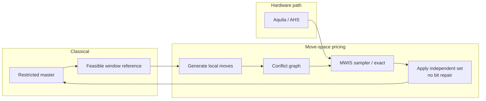

# Hybrid quantum–classical MWIS pricing for AI token factories

Public algorithm package for **move-space maximum-weight independent set (MWIS)
pricing** on a Rydberg unit-disk register, as used in energy-aware AI token-factory
scheduling. The repository ships **algorithms** and **derived QUBO matrices**
only. Raw market profiles, workload traces, and campaign logs are excluded.

## Scope

| Included | Excluded |
|----------|----------|
| 240-site unit-disk encoding (192 occupied sites) | Raw CAISO / operator CSVs |
| Move-space MWIS pipeline (exact / classical / AHS-surrogate) | Full monthly campaign outputs |
| Versioned dense \(Q\) matrices and rebuild recipes | Proprietary or unreproducible run dumps |

## Method sketch



Physical feasibility is an independent set on the unit-disk graph. Logical
move conflicts induce a sparse MWIS whose dense QUBO form is

\[
Q_{ii}=-w_i,\qquad
Q_{ij}=Q_{ji}=P/2\ \text{on conflict edges},\qquad
P=1+2\max_i|w_i|,
\]

with energy \(E(\mathbf{x})=\mathbf{x}^{\top}Q\mathbf{x}\).

## Layout

```
.
├── README.md
├── requirements.txt
├── algorithms/                 # encoding + move_wmis + QUBO helper
│   ├── encoding.py
│   ├── qubo.py
│   └── move_wmis/
├── matrices/                   # derived Q only (see matrices/README.md)
│   ├── register_unit_weight_Q.npy
│   ├── move_mwis_k64_seed104_Q.npy
│   └── move_mwis_k64_seed104_instance.json
└── scripts/
    └── export_matrices.py      # rebuild / verify hashes
```

## Environment

```bash
python -m venv .venv
# Windows: .venv\Scripts\activate
pip install -r requirements.txt
```

Python 3.10+.

## Usage

```python
from algorithms import encoding, move_wmis, build_qubo_matrix
import numpy as np

print(encoding.N_SITES, encoding.N_WEIGHTED_SITES)

Q = np.load("matrices/move_mwis_k64_seed104_Q.npy")
# E = x @ Q @ x
```

Rebuild and verify locked hashes:

```bash
python scripts/export_matrices.py
```

Canonical hashes (must match `matrices/*_meta.json`):

| Matrix | \(n\) | SHA-256 (prefix) |
|--------|------:|------------------|
| `register_unit_weight_Q.npy` | 240 | `d27660d1…` |
| `move_mwis_k64_seed104_Q.npy` | 64 | `07b6d5c4…` |

## Licence and citation

Cite this repository when reusing the encoding, move-WMIS pipeline, or matrices.
Downstream studies must not present redistributed \(Q\) files as raw sensor or
market measurements.
